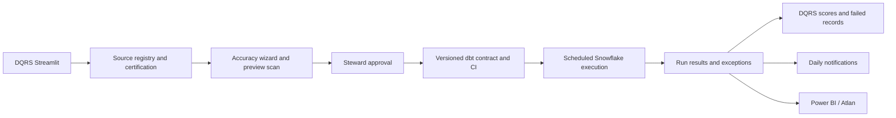
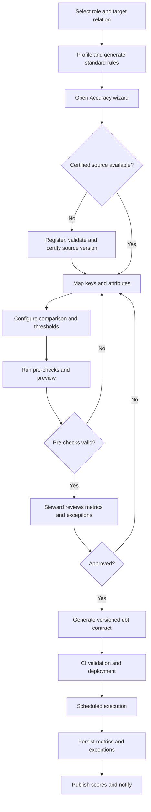

# DQRS — Accuracy Dimension Enhancement

**Version:** 1.1 | **Status:** Proposed design for review

## 1. Solution design

### 1.1 Objective and existing capabilities

Extend the Snowflake Streamlit DQRS lifecycle to measure accuracy by comparing target attributes against certified, versioned authoritative evidence. Unlike conformity, accuracy establishes whether a value agrees with an approved source of truth. Reuse the existing role selector, rule generation, requests, DQ scores and failed-record screens.

The supplied screenshots show `DATA_QUALITY_PROD_DB.ACCESS_VIEWS.DT_DQ_SCORE_TABLE_KPI` and `DT_DQ_SCORE_COLUMN_KPI` as incremental dynamic tables with a seven-day target lag. Both expose project, database, schema, table, DQ_KPI, DQ_SCORE, TOTAL_ROW_COUNT, FAILED_ROW_COUNT and creation/update dates; the column KPI also exposes COLUMN_NAME and FIRST_DETECTED_DT. The three existing violation objects (completeness, conformity, uniqueness) expose DATABASE_NAME, SCHEMA_NAME, TABLE_NAME, BUSINESS_RULE, INCORRECT_VALUE and RECORD. Their refresh settings are not confirmed. Existing history semantics and upstream definitions require verification.

### 1.2 Architecture



| Layer | Responsibility |
|---|---|
| Streamlit | Authorized context selection, source registration, mapping, preview, approval and monitoring |
| Governance | Attribute-specific certification, ownership, expiry, immutable source and rule versions |
| Snowflake | Reference storage, pre-checks, comparison, results, RBAC and scheduling support |
| dbt | Source YAML, reusable generic test, metric model, CI validation, deployment and failure capture |
| Monitoring | Accuracy and coverage KPIs, exceptions, historical trends, notifications and catalog publication |

### 1.3 Gap analysis and phased development

All names below are proposed logical objects; reuse existing equivalents if available. Columns listed are minimum expected fields, not confirmed existing DDL.

| Phase | Capability | Existing / missing details | What is needed to achieve it (expected columns) |
|---|---|---|---|
| 1 | Source registry | No certified truth registry evidenced | ACC_SOURCE: SOURCE_ID, SOURCE_NAME, SOURCE_TYPE, OWNER_ROLE, STEWARD_USER, SENSITIVITY, CREATED_BY, CREATED_AT, STATUS |
| 1 | Source version and certification | Existing KPI dates do not establish truth certification | ACC_SOURCE_VERSION: SOURCE_VERSION_ID, SOURCE_ID, VERSION_NO, REFERENCE_DATABASE, REFERENCE_SCHEMA, REFERENCE_OBJECT, CONTENT_HASH, DATA_AS_OF, MAX_AGE_HOURS, CERTIFIED_BY, CERTIFIED_AT, EFFECTIVE_FROM, EXPIRES_AT, STATUS |
| 1 | Attribute scope | Certification must apply to specific attributes | ACC_SOURCE_ATTRIBUTE: SOURCE_VERSION_ID, COLUMN_NAME, DATA_TYPE, CERTIFIED_SCOPE, IS_KEY, SENSITIVITY |
| 2 | Rule configuration | BUSINESS_RULE alone is not a stable versioned identifier | ACC_RULE_VERSION: RULE_ID, RULE_VERSION_ID, VERSION_NO, PROJECT_NAME, TARGET_DATABASE, TARGET_SCHEMA, TARGET_TABLE, SOURCE_VERSION_ID, SCOPE_FILTER, MIN_ACCURACY_PCT, MIN_COVERAGE_PCT, SEVERITY, STATUS, CREATED_BY, CREATED_AT |
| 2 | Key and value mapping | No explicit mappings in existing violation schemas | ACC_RULE_MAPPING: RULE_VERSION_ID, MAPPING_ID, MAPPING_TYPE, ORDINAL, TARGET_COLUMN, TRUTH_COLUMN, COMPARISON_TYPE, NORMALIZATION, TOLERANCE, TOLERANCE_UNIT, NULL_POLICY |
| 2 | Scan execution | Existing scores do not show comparable population or source version | ACC_RUN_RESULT: RUN_ID, RULE_VERSION_ID, SOURCE_VERSION_ID, RUN_TYPE, STARTED_AT, COMPLETED_AT, DATA_AS_OF, EXECUTION_STATUS, RULE_STATUS, SCORABLE, UNSCORABLE_REASON, IN_SCOPE_COUNT, COMPARABLE_COUNT, MATCH_COUNT, MISMATCH_COUNT, NO_MATCH_COUNT, MULTIPLE_MATCH_COUNT, ACCURACY_PCT, COVERAGE_PCT, ERROR_MESSAGE |
| 2 | Failed records | Current six-column structure lacks expected value and run lineage | ACC_EXCEPTION: RUN_ID, RULE_VERSION_ID, SOURCE_VERSION_ID, RECORD_KEY, MAPPING_ID, ACTUAL_VALUE, EXPECTED_VALUE, REASON_CODE, TARGET_RECORD, DETECTED_AT |
| 3 | Steward approval | Existing approval reuse must be verified | ACC_APPROVAL: APPROVAL_ID, RULE_VERSION_ID, PREVIEW_RUN_ID, DECISION, DECIDED_BY, DECIDED_AT, COMMENTS |
| 3 | dbt deployment | Need reproducible contract | ACC_DEPLOYMENT: DEPLOYMENT_ID, RULE_VERSION_ID, SOURCE_VERSION_ID, CONTRACT_HASH, GIT_COMMIT, DBT_TEST_ID, SCHEDULE_ID, STATUS, DEPLOYED_AT, ERROR_MESSAGE |
| 4 | Daily refresh and KPI history | KPI target lag is seven days; daily execution not established | DQ_RULE_DAILY_RESULT: SNAPSHOT_DATE, RUN_ID, RULE_ID, RULE_VERSION_ID, DQ_KPI, FAILED_COUNT, TOTAL_COUNT, RULE_STATUS, ACCURACY_PCT, COVERAGE_PCT, DATA_AS_OF; retain successful zero-failure results |
| 4 | Record lifecycle | Current violations do not expose stable record history | DQ_EXCEPTION_STATE: RULE_VERSION_ID, RECORD_KEY, MAPPING_ID, REASON_CODE, FIRST_SEEN_AT, LAST_SEEN_AT, RESOLVED_AT, STATUS |
| 4 | Notification subscriptions | Existing email helper is interactive/admin oriented | DQ_SUBSCRIPTION: SUBSCRIPTION_ID, USER_ID, AUTHORIZED_ROLE, DATABASE_NAME, SCHEMA_NAME, TABLE_NAME, RULE_ID, DQ_KPI, EVENT_TYPE, FREQUENCY, THRESHOLD, ENABLED, CREATED_AT |
| 4 | Notification audit | Delivery and deduplication not evidenced | DQ_NOTIFICATION_LOG: NOTIFICATION_ID, SUBSCRIPTION_ID, RUN_ID, EVENT_KEY, RECIPIENT, STATUS, ATTEMPT_COUNT, SENT_AT, ERROR_MESSAGE |
| 4 | Operational monitoring | Need unattended run and refresh checks | DQ_JOB_RUN: JOB_RUN_ID, SCHEDULED_AT, STARTED_AT, COMPLETED_AT, STATUS, UPSTREAM_RUN_ID, ERROR_MESSAGE |
| 5 | Excel/CSV intake | Proposed additional source path | ACC_SOURCE_UPLOAD: UPLOAD_ID, SOURCE_VERSION_ID, STAGE_PATH, FILE_NAME, FILE_HASH, UPLOADED_BY, UPLOADED_AT, VALIDATION_STATUS, ERROR_MESSAGE |

### 1.4 Data model and integrity

- Source → source versions → certified attributes; rule → rule versions → mappings; approved rule version → deployment → runs → exceptions.
- Use stable IDs and immutable approved versions. Enforce logical uniqueness in application/procedure logic (standard Snowflake table PK/unique constraints are generally informational).
- Store reference snapshots in a governed schema such as `DATA_QUALITY_PROD_DB.ACCURACY_REFERENCE`; a mutable view alone does not guarantee reproducibility.
- Store timestamps with timezone-aware semantics; retain source data-as-of separately from execution time. Use NUMBER for counts, numeric percentages, VARIANT for structured keys and protected record payloads.
- Define record identity using approved business keys; for duplicate target keys require a stable row identifier or explicitly reject the scan. Never infer identity from incorrect value alone.

### 1.5 Comparison and scoring

Phase 2 baseline: one compared attribute per rule; composite join keys supported. Compare exact values first; add approved normalization, numeric/date tolerances and explicit null handling. Use a left join to preserve all in-scope target records; pre-aggregate truth key multiplicity to avoid join fan-out. Treat zero matches and multiple matches separately. Reject invalid casts and invalid key configurations or explicitly classify them as unscorable.

- Accuracy % = 100 × matching records / comparable records.
- Coverage % = 100 × records with exactly one authoritative match / records in scope.
- Comparable records are those with exactly one truth match and a valid comparison under the configured null/type policy. If invalid comparisons are allowed, capture their count separately and distinguish comparable count from exactly-one-match count.
- Zero denominators produce NULL, not 100%. A score is publishable only with valid certification, current source/scan, minimum coverage and valid pre-checks. Accuracy threshold determines pass/fail for scorable runs; coverage failure is a separate alert.

| Example metric | Value |
|---|---:|
| Target records in scope | 1,000 |
| Comparable | 900 |
| Matching | 855 |
| Mismatch | 45 |
| No authoritative match | 100 |
| Accuracy | 95% |
| Coverage | 90% |

Do not combine these into 85.5%. Standard reason codes: VALUE_MISMATCH, NO_AUTHORITATIVE_MATCH, MULTIPLE_AUTHORITATIVE_MATCHES, TOLERANCE_EXCEEDED. Proposed additional code: INVALID_COMPARISON.

### 1.6 Integration with existing DQRS

Expose a proposed `DT_ACCURACY_VIOLATIONS` compatibility projection with the existing six columns plus RULE_ID, RULE_VERSION_ID, SOURCE_VERSION_ID, RUN_ID, COLUMN_NAME, RECORD_KEY, EXPECTED_VALUE, REASON_CODE and DETECTED_AT. Keep sensitive values masked. Add Accuracy to existing score views using explicitly defined aggregation; do not sum overlapping failed rows as distinct records or average percentages without agreed weighting. Publish coverage and scorable status alongside accuracy. Preserve historical runs in persistent tables rather than relying on dynamic-table refresh history.

### 1.7 Scheduling, notifications and security

Use the existing dbt scheduler if available, otherwise an approved Snowflake task/orchestrator. Daily sequence: upstream data ready → reference health check → dbt tests and metric computation → persist run results → refresh dependent KPI/violation objects → verify freshness → evaluate subscriptions → send digest. A seven-day target lag is not a daily execution schedule; coordinate dynamic-table lag or explicit refresh with upstream completion. Do not report stale results as current. Treat dbt assertion failures as data outcomes, not infrastructure failures; still capture metrics and exceptions. Do not mark failures resolved when a run is missing, failed or unscorable.

Use SQL/Snowpark stored procedures independent of Streamlit for notification delivery. Revalidate recipient access and verified email eligibility, confirm integration name, send aggregate summaries with authorized dashboard links rather than sensitive raw values. Deduplicate by subscription, event and run; retry with bounded attempts and log uncertain delivery. Immediate alerts mean immediately after detection, not continuous monitoring unless separately scheduled.

Roles: requester (draft/scan), steward (certify/approve), dbt execution role (USAGE/SELECT on both relations and required write privileges), administrator (configuration), subscriber (authorized results). Enforce object-level access server-side, not just dropdown filtering. Bind values, validate identifiers and restrict configurable SQL expressions to approved patterns. Apply masking and retention policies; audit approval, deployment and access changes.

## 2. Design flow



### Source intake

Snowflake table/secure view → validate grants, owner, metadata, key uniqueness, freshness and effective dates → create governed version → certify attributes. Excel/CSV (phase 5) → validate file type, headers, schema and duplicates → retain original securely → load immutable reference version → same certification process. dbt receives a stable relation and source version ID, never an unmanaged attachment.

### Lifecycle and deployment

Rule states: DRAFT → PREVIEWED → PENDING_APPROVAL → APPROVED → DEPLOYED → ACTIVE → RETIRED. Rejection returns to draft; edits to approved rules create a new version. Compare versions and preview both on a common population where feasible. Deployment failure does not replace the active version. Rollback redeploys an approved prior contract only if its reference certification remains valid.

## 3. UI design

Layouts include visual concept mockups and textual wireframes for Streamlit; example values are illustrative. Keep existing DQRS tabs and add Accuracy Management with Overview, Source Management, Rule Management, Governance & Deployment, Administration. Shared monitoring remains in existing DQ scores/failed records and a shared notifications section.

| Screen / phase | Layout and fields | Actions and validations |
|---|---|---|
| Overview / 4 | KPI cards: accuracy, coverage, active rules, unscorable rules; filters role/database/schema/table; trends and source health | Drill to rule/run; show as-of and stale status |
| Source Registry / 1 | Searchable source list: ID, owner, relation, type, version, status, expiry | Register, view, create version; verify grants |
| Certification / 1 | Source details, certified attribute list, key uniqueness, freshness, sensitivity, effective/expiry dates, comments | Certify/reject; steward-only; require validation and comments |
| Accuracy Rules / 2 | Rule ID, target, source version, accuracy, coverage, status, version | Create, edit draft, compare, retire |
| Accuracy Wizard / 2 | Stepper: target → truth → keys → values → thresholds → preview | Validate each step; require certified source and compatible mappings |
| Scan Results / 2 | Accuracy/coverage cards, scope/comparable/match counts, exception breakdown, run metadata | Preview, export authorized data, submit for approval |
| Steward Approval / 3 | Queue, rule configuration, preview, source certification, comments | Approve/reject exact version; revalidate certification |
| Version Comparison / 3 | Side-by-side source, mappings, scope, thresholds and preview metrics | Changes-only filter; warn if populations differ |
| dbt Deployment / 3 | Contract preview, YAML, test ID, grants, CI status, schedule, commit | Export contract, request deployment, retry/rollback with authorization |
| Failed Records / 4 | Accuracy sub-tab; rule/run/reason filters; actual vs expected; key and lineage | Drill through, authorized export, history; mask sensitive fields |
| Execution History / 4 | Run ID, date, status, duration, accuracy, coverage, source version | Compare runs, view errors, rerun authorized jobs |
| Source Health / 4 | Freshness, certification expiry, impacted rules, last validation | View dependencies, request recertification |
| Notifications / 4 | Scope database/schema/table/rule, event types, daily/immediate, recipient | Opt in/out; validate recipient and access; show delivery history |
| Administration / 1 | Default thresholds, warehouse, role, schedule, retention | Admin-only save; audit changes |
| File Intake / 5 | Upload, schema preview, mapping, validation report | Reject malformed files; version and certify valid data |

### Streamlit implementation approach

The visual mockups show only the functional content area; reuse the existing DQRS navigation, application header and role selector. Do not add a duplicate sidebar, branding or breadcrumbs. Screen titles are local to the content area.

| UI element | Native Streamlit approach |
|---|---|
| Section navigation | `st.tabs()` within existing application |
| Filters and selection | `st.selectbox()`, `st.text_input()` |
| Registry and results | `st.dataframe()` with row selection where supported; otherwise selectbox |
| Wizard | `st.session_state`, `st.form()`, `st.progress()` |
| Key and attribute mapping | `st.data_editor()` |
| KPI cards | `st.columns()`, `st.metric()` |
| Approval | `st.text_area()`, `st.button()` |
| Status | `st.badge()` where supported, otherwise text or status messages |
| YAML | `st.code()`, `st.download_button()` where supported |
| Trends | `st.altair_chart()` |

Confirm widget availability in the deployed Snowflake Streamlit runtime. Exact mockup styling is illustrative; use native widgets first. Backend authorization, persistence, scheduling and dbt CI/CD must be implemented separately. The four visual references cover the primary workflow; the screen inventory above specifies the remaining screens. Use the standalone YAML rather than the image text.

### Wireframe A — Source registry


```text
[+ Register Source]
[Search sources] [Status: All] [Owner: All]
Source ID | Reference object | Version | Owner | Certification | Expiry
SRC-001   | CUSTOMER_REF_V2  | 2       | MDM   | Certified     | ...
[View details] [New version] [Certification history]
```

### Wireframe B — Accuracy wizard


```text
1 Target > 2 Truth > 3 Keys > 4 Values > 5 Thresholds > 6 Preview
Target: EDW_PROD_DB.CUSTOMER.CUSTOMER_MASTER
Truth:  DATA_QUALITY_PROD_DB.ACCURACY_REFERENCE.CUSTOMER_REF_V2
Source version: SRC-001-V2    Certification: Valid
Target key        Truth key
CUSTOMER_ID       CUSTOMER_ID          [+ Add key]
Target attribute  Truth attribute      Method
DATE_OF_BIRTH     BIRTH_DATE           Exact
Scope: All records   Null policy: Explicit mismatch
Min accuracy: 95%    Min coverage: 90%   Severity: High
[Back] [Save draft] [Validate & Scan]
```

### Wireframe C — Scan and approval


```text
Accuracy 95%     Coverage 90%     Scorable: Yes
In scope 1000    Comparable 900   Matching 855
Mismatch 45      No truth match 100    Multiple match 0
[Exceptions] [Pre-checks] [Run metadata] [Compare versions]
Record key | Actual | Expected | Reason
C1001      | ...    | ...      | VALUE_MISMATCH
[Submit for approval]
Steward view: [Comments] [Reject] [Approve version]
```

### Wireframe D — Deployment and monitoring


```text
Rule ACC-001 | Rule version 1 | Source version 2
[Contract] [YAML] [Required grants] [CI status]
Schedule: Daily after upstream completion
[Export YAML] [Request deployment]
Run history: Date | Accuracy | Coverage | Rule status | Exceptions
[View failed records] [Subscribe] [Notification history]
```

The images are illustrative UI concepts; use the written requirements and YAML below as the implementation reference.

## 4. Sample YAML for dbt team

The accompanying `dqrs_accuracy_example.yml` uses modern dbt generic-test `arguments` syntax (confirm installed dbt version). It is a proposed interface, not a built-in dbt test. Implement the custom macro `dqrs_accuracy`, metric model and result ingestion before execution. Source identifiers and thresholds are examples.


```yaml
version: 2

sources:
  - name: dqrs_target
    database: EDW_PROD_DB
    schema: CUSTOMER
    tables:
      - name: customer_master
        identifier: CUSTOMER_MASTER
        data_tests:
          - dqrs_accuracy:
              name: acc_001_customer_dob_v1
              arguments:
                truth_relation: "{{ source('dqrs_truth', 'customer_ref_v2') }}"
                rule_id: ACC-001
                rule_version_id: ACC-001-V1
                source_version_id: SRC-001-V2
                key_mappings:
                  - target: CUSTOMER_ID
                    truth: CUSTOMER_ID
                target_column: DATE_OF_BIRTH
                truth_column: BIRTH_DATE
                comparison_type: exact
                normalization: none
                null_policy: mismatch
                tolerance: 0
                tolerance_unit: days
                scope_filter: "1 = 1"
                min_accuracy_pct: 95
                min_coverage_pct: 90
              config:
                severity: error
                store_failures: true
                tags: [dqrs, accuracy, daily]
                meta:
                  dqrs_severity: high
                  schedule_id: DAILY_AFTER_UPSTREAM
                  owner_role: CUSTOMER_DATA_STEWARD
  - name: dqrs_truth
    database: DATA_QUALITY_PROD_DB
    schema: ACCURACY_REFERENCE
    tables:
      - name: customer_ref_v2
        identifier: CUSTOMER_REF_V2
        columns:
          - name: CUSTOMER_ID
            data_tests: [not_null, unique]
```

### dbt implementation contract

The generic test must return a failing assertion row when accuracy or coverage is below threshold, or the run is unscorable. A separate reusable comparison model must produce detailed exceptions and aggregate metrics from the same run/population; do not confuse the generic test assertion row count with failed source records. `store_failures` persists test output, not durable record history. Persist comparison exceptions and metrics independently, including passing runs. Capture dbt invocation ID and test unique ID in run metadata. CI must compile the YAML, validate the custom macro signature, verify source grants and run fixture tests. The schedule tag/meta are descriptive; configure the actual scheduler separately.

Suggested commands after implementation: `dbt parse`, `dbt compile`, `dbt test --select acc_001_customer_dob_v1`. Ensure the comparison model executes first if required by the implementation. Configure the audit schema and write grants explicitly.

## 5. Acceptance criteria and open decisions

| Phase | Acceptance criteria |
|---|---|
| 1 | Unauthorized users cannot certify; invalid/expired references cannot be used; versions are reproducible |
| 2 | Example yields 95% accuracy and 90% coverage; test no match, duplicate truth, null, invalid cast, zero scope and tolerance boundaries |
| 3 | Only approved versions deploy; CI rejects invalid contract; version comparison and rollback audited |
| 4 | Daily runs preserve zero failures and stale/error status; notification retries and deduplication tested; access revocation blocks delivery |
| 5 | Invalid uploads rejected; valid files retained and versioned with certification |

Open decisions: confirm existing DQRS rule/approval tables, upstream dbt scheduler, dynamic-table definitions and refresh history, rule and record identity, KPI aggregation, null semantics, coverage policy, source freshness SLA, role grants, email integration, retention, notification timing and catalog publishing mechanism. Proposed thresholds (95% accuracy, 90% coverage), one attribute per rule, phase boundaries and object names require approval. No live Snowflake or repository inspection was performed for this document; no application or database changes were made.
